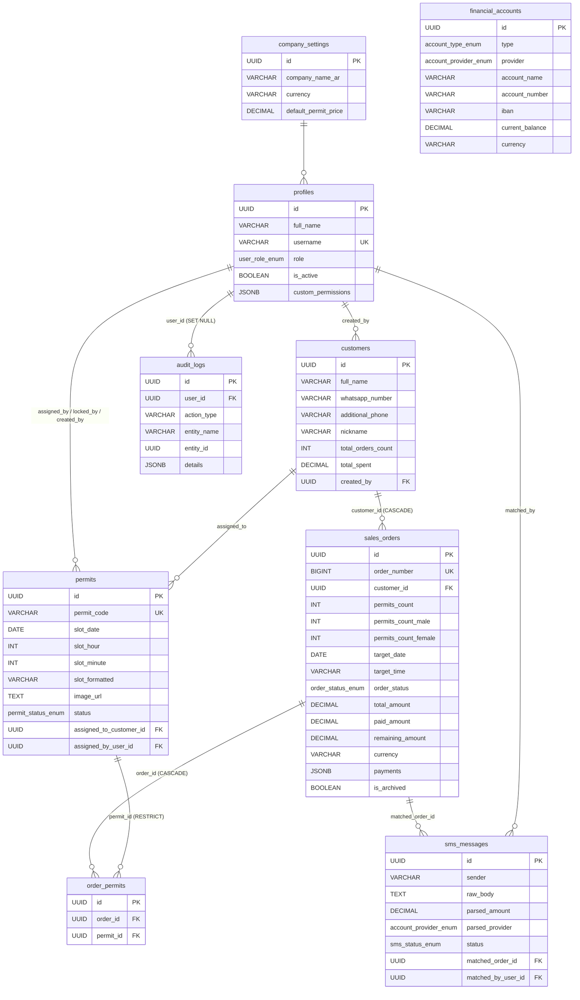

# تقرير تحليل شامل — نظام حجز وإدارة تصاريح الروضة الشريفة (Rawdah Enterprise)

> وثيقة تحليل هندسي مبنية على قراءة الكود المصدري الفعلي فقط. كل معلومة موثّقة بمسار الملف (ورقم السطر حيث أمكن). المميّز: **[مؤكد من الكود]** / **[استنتاج]** / **[غير موجود]**.

---

## ملخص تنفيذي

نظام إدارة وحجز تصاريح الروضة الشريفة هو تطبيق صفحة واحدة (SPA) مبني بـ React 18 + Vite 6 + TypeScript، يعتمد على Supabase كسحابة (قاعدة PostgreSQL + Storage + Auth + Realtime)، ويستخدم **localStorage كطبقة التخزين الأساسية** مع مزامنة سحابية ثنائية الاتجاه. يضم 4 أدوار (مدير عام، مبيعات، مخزون، محاسب) بصلاحيات مخصصة (view/create/edit/delete/reports)، ووحدات: تسجيل دخول، مخزون تصاريح (24 ساعة × 3 فترات/20 دقيقة = 72 فترة يومياً)، طلبات بيع، عملاء، مطابقة سداد عبر SMS، حسابات مالية، إدارة موظفين، إعدادات، وسجل تدقيق. حجم المشروع ~17,500 سطر عبر ~36 ملفاً. أهم المخاطر: ملف `fix_all_rls_and_sync.sql` يلغي سياسات RLS المتقنة في `schema.sql` ويفتح كل الجداول للزائر المجهول، ومفتاح anon مثبّت في الكود (`supabase.ts`)، ولا يوجد rate limiting أو CAPTCHA أو خاصية تحقق عند البوابة، وكلمات المرور تُجزّأ بـ SHA-256 بلا ملح، وأدنى طول كلمة مرور 4 أحرف. التطبيق يعمل دون سحابة (وضع محلي بالكامل) ويتحول للسحابة عند توفر بيانات الاتصال.

---

## 1. نظرة عامة

**الغرض:** منصة داخلية لمؤسسة تنظّم تصاريح زيارة الروضة الشريفة: ترفع صور التصاريح الرسمية (لقطة شاشة تصريح نسك/توكلنا)، تُوزّع على فترات زمنية، تُباع كطلبات للعملاء، ويُتابع سدادها عبر مطابقة رسائل تحويل بنكي (SMS) آلياً، مع تقارير تحصيل يومية لكل موظف.

**المستخدمون:**
- مدير عام (super_admin): إدارة كاملة + إعدادات + موظفون + تقارير.
- مبيعات (sales): إنشاء طلبات، سحب/تخصيص تصاريح، عملاء.
- مخزون (inventory): رفع تصاريح، نقل/أرشفة، سحب تصاريح.
- محاسب (accountant): رسائل SMS والسداد، الحسابات المالية، التقارير وسجل التدقيق.
- عميل (عام): تسجيل ذاتي عبر رابط `?register=true` بلا مصادقة.

**حجم المشروع [مؤكد]:**
- `src/` ≈ 17,447 سطر عبر 34 ملفاً (أكبر ملف `dataService.ts` ≈ 4,290 سطر، ثم `demoData.ts` ≈ 690، `OrdersManagement.tsx`/`PermitsInventory.tsx`/`SmsInbox.tsx` كبيرة).
- `api/` ≈ 40 سطر عبر ملفين.
- `database/` 4 ملفات SQL.

**التقنيات والإصدارات [مؤكد من package.json]:**
| التقنية | الإصدار |
|---|---|
| React | ^18.3.1 |
| Vite | ^6.2.0 |
| TypeScript | ^5.7.3 |
| @supabase/supabase-js | ^2.49.1 |
| tailwindcss | ^3.4.17 |
| qrcode | ^1.5.4 |
| date-fns | ^4.1.0 |
| canvas-confetti | ^1.9.4 |
| lucide-react | ^1.16.0 |

ملاحظة: `tsconfig.json` يضبط `"strict": false` [مؤكد] — ضعف في صرامة الأنواع.

---

## 2. الأدوار والصلاحيات

### جدول الأدوار
| الدور | الشاشات المتاحة | الصلاحيات الافتراضية |
|---|---|---|
| **super_admin** | كل الشاشات | view+create+edit+delete+reports = true دائماً (ثابتة غير قابلة للتعديل) [مؤكد Sidebar.tsx + EmployeesAndRolesView] |
| **sales** | لوحة المؤشرات، الفترات، الطلبات، العملاء | view+create+edit = true; delete=false; reports=false |
| **inventory** | لوحة المؤشرات، الفترات | view+create+edit = true; delete=false; reports=false |
| **accountant** | لوحة المؤشرات، الطلبات، الرسائل، الحسابات، سجل التدقيق | view+create+edit+reports = true; delete=false |

مصفوفة شاشة-دور [مؤكد Sidebar.tsx NAV_ITEMS]:
- لوحة المؤشرات: الجميع (تحتاج `view`)
- الفترات: super_admin, sales, inventory
- الطلبات: super_admin, sales, accountant
- العملاء: super_admin, sales
- الرسائل SMS: super_admin, accountant
- الحسابات المالية: super_admin, accountant (تحتاج `reports`)
- الموظفون: super_admin فقط
- الإعدادات: super_admin فقط
- سجل التدقيق: super_admin, accountant (تحتاج `reports`)

### كيف تُفرض الصلاحيات
1. **الواجهة الأمامية (client-side):** `getVisibleNavTabs(role, customPermissions)` في `Sidebar.tsx` تُخفي التبويبات غير المسموحة. و`App.tsx` يحسب `effectiveTab` أثناء الرندر فلا تُعرض شاشة ممنوعة ولو للحظة، وبوابة `handleNavigate` ترفض التنقل المباشر مع تنبيه [مؤكد App.tsx]. كل مكوّن يُخفي أزراره عبر `role === 'super_admin' || customPermissions?.create/edit/delete` [مؤكد].
2. **الجلسة:** `DataService.getCurrentUser()` يقرأ المستخدم من `localStorage` فقط [مؤكد dataService.ts ~1420] — جلسة يحكمها العميل بالكامل.
3. **الخلفية (Supabase RLS):** ملف `schema.sql` يطبّق أقل امتياز (التفاصيل في §8). لكن ملف `fix_all_rls_and_sync.sql` **يستبدل** كل سياسة بـ `FOR ALL TO anon, authenticated USING(true) WITH CHECK(true)` على كل الجداول [مؤكد] — ما يُلغي الحماية فعلياً إن طُبّق.

### نقاط بلا حماية كافية
- **التسجيل الذاتي للعملاء** (`CustomerSelfRegister.tsx`): صفحة عامة بلا مصادقة، بلا rate limiting، بلا CAPTCHA — أي شخص يملك الرابط ينشئ سجلات عملاء [مؤكد].
- **محاكاة SMS** (`SmsInbox.tsx`): أي مستخدم مسجّل (ولو مبيعات) يمكنه إدخال رسالة تحويل وهمية تُطابَق آلياً فتُعلّم طلباً بأنه مسدّد [مؤكد - استنتاج أثر: تزوير سداد].
- **كل أزرار التشغيل في الطلبات** (تغيير حالة، سداد، إرسال واتساب، أرشفة، تصدير) **بلا فحص دور/صلاحية** — فقط زر إنشاء الطلب مقيّد بـ `create` [مؤكد OrdersManagement.tsx].
- **نقل التصاريح** `canMove = true` للجميع [مؤكد PermitsInventory.tsx].
- الجلسة محلية بالكامل: تعديل `localStorage` من أدوات المتصفح يغيّر الدور والصلاحيات [مؤكد - طبيعة التصميم].

---

## 3. الوحدات الوظيفية

### 3.1 تسجيل الدخول
- **الملفات:** `LoginScreen.tsx`، `services/supabase.ts`، `utils/passwordHash.ts`، `database/rpc_functions.sql` (`rpc_authenticate_user`).
- **الوصف:** ثلاث مسارات بالترتيب: (1) استدعاء `rpc_authenticate_user` السحابي، (2) Supabase Auth `signInWithPassword`، (3) مطابقة بروفايل محلي مع كلمة مرور مشفّرة محلياً [مؤكد LoginScreen.tsx].
- **المدخلات:** اسم المستخدم (يُحوّل لبريد `<user>@rawdah.app` عبر `toAuthEmail`) + كلمة المرور.
- **المخرجات:** كائن `UserProfile` يُحفظ في localStorage + علم جلسة `rawdah_session_logged_in`.
- **التحقق:** رفض الحساب الموقوف `isActive=false` في كل مسار. فحص `normUsername` لمطابقة الاسم المختصر/الكامل/البريد.
- **حالات الخطأ:** "اسم المستخدم أو كلمة المرور غير صحيحة"، "الحساب موقوف"، تأخير اصطناعي 300ms للرسم.
- **ملاحظة أمنية:** في المسار المحلي، إن لم يكن للبروفايل كلمة مرور مسجلة سابقاً، تُعتمد كلمة المرور المدخلة ككلمة مرور الحساب فوراً [مؤكد LoginScreen.tsx ~السطر بعد localProfile] — يعني أن معرفة اسم مستخدم فقط تتيح تعيين كلمة مرور لحساب بلا كلمة مرور.
- **تناقض [مؤكد]:** `rpc_authenticate_user` يرجع إلى عمود `password_hash` وعمود `"fullName"` (camelCase محاط بأقوال) في جدول `profiles`، بينما `schema.sql` يعرّف العمود `full_name` (snake_case) ولا يعرّف `password_hash` إطلاقاً. هذا يعني أن الدالة ستفشل بخطأ "column does not exist" إن طُبّقت على قاعدة متطابقة مع `schema.sql`، فيسقط المسار الأول ويعتمد التطبيق على Supabase Auth أو البروفايل المحلي [استنتاج مبني على قراءة الملفين].

### 3.2 البحث عن المواعيد / مخزون التصاريح
- **الملفات:** `PermitsInventory.tsx`، `dataService.addPermitsBulk`/`claimPermit`/`returnPermit`/`movePermits`/`archivePastPermits`/`autoExpirePermits`.
- **الوصف:** شبكة 24 ساعة × 3 فترات (00/20/40) = حتى 72 فترة يومياً، كل فترة 20 دقيقة. تُرفع صور التصاريح (ضغط إلى 800px عبر `compressImageFile`) لفترة محددة، يُولّد كود `PERMIT-HHMM-seq` تسلسلي لكل صورة.
- **المدخلات:** تاريخ + ساعة + دقيقة + صور (ملفات أو روابط خارجية) + ملاحظات.
- **المخرجات:** كائنات `Permit` تُحفظ محلياً وتُرفع للسحابة، والصور تُرفع إلى Supabase Storage (bucket=`permits`) أو تبقى base64 محلياً كاحتياط.
- **التحقق:** رفض الصور غير الصالحة أو الأكبر من 10MB (`validateImageFile`). منع سحب تصريح انتهت فترته (`isSlotPast` بـ grace 20 دقيقة).
- **حالات الخطأ:** فشل الرفع للسحابة → احتياط base64 محلي. فشل رفع الصورة → تنبيه.

### 3.3 الحجز (إنشاء الطلب وتخصيص التصريح)
- **الملفات:** `OrdersManagement.tsx`، `dataService.createOrder`/`claimPermit`.
- **الوصف:** يُنشأ طلب (رقم تسلسلي يبدأ من 1001، يُحسب `Math.max+1` محلياً؛ في السحابة `BIGSERIAL` آلياً). عدد التصاريح ذكر/أنثى (0-50). سداد مبدئي يُسجّل في `payments[]` ويزيد رصيد الخزينة. ثم تُخصّص التصاريح من المخزون.
- **المدخلات:** عميل، عدد (ذكور/إناث)، تاريخ وفترة مستهدفة، نوع (فوري/مجدول)، سعر الوحدة، مبلغ مدفوع، عملة (SAR/EGP).
- **المخرجات:** `SalesOrder` + ربط تصاريح عبر `order_permits` + تحديث حالة الطلب لتؤكد تلقائياً عند أول تخصيص تصريح [مؤكد claimPermit].
- **قاعدة ذرية [مؤكد]:** عند تفعيل السحابة، `claimPermit` ينفّذ تحديثاً مشروطاً `.update(...).eq('id',id).eq('status','available')` ويتحقق من عدد الصفوف المتأثرة — إن صفر والتصريح موجود سحابياً يعني أن موظفاً آخر سبق به، فيُحدّث المحلي ويرفض. هذا الحارس الخادمي الوحيد المؤكد.
- **حالات الخطأ:** "تم حجزه بالفعل من موظف آخر"، "انتهت الفترة الزمنية"، "العميل غير موجود"، "تعذر التثبيت في السحابة".

### 3.4 إصدار التصريح وQR
- **الملفات:** `utils/printHelpers.ts` (`buildQrDataUrl`, `printOrderReceipt`, `printPermit`)، `OrdersManagement.tsx` (باني رسالة واتساب).
- **الوصف:** كود التصريح نص تسلسلي `PERMIT-HHMM-seq` [مؤكد addPermitsBulk] — ليس QR ولا باركود. الصورة الرسمية للتصريح هي ما يرفعه الموظف (`permit.imageUrl`). عند الطباعة/الإرسال يُولّد `printHelpers` رمز QR عبر مكتبة `qrcode` لمحتوى الطلب/التصريح [مؤكد]. رسالة الواتساب تتضمن الكود + رابط الصورة (إن كان https) + تفاصيل الحسابات البنكية.
- **ملاحظة:** لا يوجد توليد للباركود الرسمي للتصريح — التطبيق ي merely يخزّن ويعرض صورة التصريح الرسمية.

### 3.5 التعديل/الإلغاء
- **الملفات:** `dataService.updateOrderStatus`/`returnPermit`/`deletePermit`/`deletePermitsBulk`/`setOrderArchived`.
- **الوصف:** إلغاء الطلب يُرجع كل تصاريحه المخصصة للمخزون (status→available) ويفك ربطها سحابياً [مؤكد updateOrderStatus]. إرجاع تصريح منفرد يُعيده متاحاً. الحذف مقيّد عميلياً بـ `delete`.
- **مهلة الإلغاء [غير موجود]:** لا توجد مهلة زمنية للإلغاء — يُلغى في أي وقت.

### 3.6 لوحة الإدارة / لوحة المؤشرات
- **الملفات:** `Dashboard.tsx`، `dataService.buildOwnerDailyReport`/`getDailyCollectorReport`/`getPermitPeriodReports`/`getDailyPaymentSummary`.
- **الوصف:** مؤشرات (تصاريح متاحة، طلبات، رسائل غير مطابقة، تحصيل مقسّم SAR/EGP)، التقرير اليومي للمالك (يُرسل عبر واتساب `wa.me`)، تقرير تحصيل لكل موظف (عدد عمليات السداد، المبلغ، التصاريح المسحوبة، الطلبات المنشأة)، متأخرات السداد، دليل الإعداد، خط زمني للنشاط.
- **ملاحظة أمنية:** لوحة المؤشرات تعرض الإيراد المحصّل وتقرير تحصيل الموظفين لأي مالك لصلاحية `view` [مؤكد] — بلا فحص `reports` إضافي داخل المكوّن.

### 3.7 التحقق عند البوابة
- **[غير موجود]:** لا توجد في الكود أي وحدة أو صفحة أو endpoint للتحقق من التصريح عند البوابة (لا مسح QR، لا بحث بكود التصريح، لا حالة "تم الدخول"). التحقق الوحيد هو `isSlotPast` الذي يمنع سحب تصريح منتهي الفترة. بافتراض أن الحارس يعتمد على التصريح المطبوع/الصورة الرسمية خارج النظام [استنتاج].

### 3.8 الإشعارات
- **الملفات:** `dataService.initRealtimeListener`، `App.tsx` (أحداث `rawdah_sms_incoming`، `rawdah_customer_incoming`).
- **الوصف:** اشتراك Supabase Realtime في 8 جداول (قناة مستقلة لكل جدول). عند ورود رسالة SMS جديدة (من هاتف الأندرويد الموجّه)، يُحلّل ويُطابق آلياً وتظهر Toast "تم استقبال سداد فوري". العميل المسجّل ذاتياً يُطلق Toast "عميل جديد". لا توجد إشعارات Push/بريد — فقط Toast داخل التطبيق ورسائل واتساب يفتحها المستخدم يدوياً.

### 3.9 التقارير
- **الملفات:** `AuditLogViewer.tsx`، `Dashboard.tsx`، `utils/csvHelpers.ts` (تصدير CSV مع حماية من حقن الصيغ)، `api/audit-logs/export.ts`.
- **الوصف:** تصدير CSV للسجلات/العملاء/الطلبات/تقارير الفترات. تقرير المالك اليومي. تقرير المحصّلين لكل موظف.
- **ملاحظة:** `api/audit-logs/export.ts` يُعيد **CSV ثابت ببيانات تجريبية hardcoded** ولا يستعلم من أي مصدر بيانات، وبلا مصادقة [مؤكد]. فائدة تشغيلية شبه معدومة.

---

## 4. قواعد العمل

| القاعدة | القيمة | الدليل |
|---|---|---|
| **السعة اليومية للفترات** | 24 ساعة × 3 (00/20/40) = 72 فترة | `PermitsInventory.tsx`، `schema.sql` (CHECK slot_minute IN (0,20,40), slot_hour 0-23) |
| **حد الإتاحة لكل فترة** | غير محدود — تُرفع أي صور متتالية | لا قيد في `addPermitsBulk` [مؤكد] |
| **المدة/الحد الزمني** | فترة 20 دقيقة + سماح 20 دقيقة بعد بداية الفترة قبل الانتهاء | `csvHelpers.isSlotPast(graceMinutes=20)` |
| **تقسيم رجال/نساء/عائلات** | `permitsCountMale`/`permitsCountFemale` اختياري، 0-50، يُجمَع في `permitsCount` | `OrdersManagement.tsx` (max=50)، `schema.sql` |
| **حد الحجز لكل شخص** | **غير موجود** — لا حد أقصى لطلبات/تصاريح العميل | لا قيد في `createOrder`/`claimPermit` [مؤكد] |
| **سعر التصريح الافتراضي** | 150 SAR قابل للتعديل | `company_settings.default_permit_price`، `mockData.ts` |
| **العملات** | SAR (ر.س) و EGP (ج.م)؛ مزودو EGP: vodafone/orange/etisalat/instapay؛ SAR: al_rajhi/al_ahli/riyad_bank | `currency.ts`، `schema.sql` |
| **مهلة الإلغاء** | **غير موجود** — يُلغى في أي وقت | لا قيد زمني في `updateOrderStatus` |
| **التأكيد التلقائي للطلب** | تخصيص أي تصريح → `orderStatus='confirmed'`؛ السداد الكامل → `confirmed` | `claimPermit`، `applySmsPaymentCore` |
| **الأرشفة التلقائية للطلب** | مسدود بالكامل + انقضاء موعد الزيارة | `isOrderArchiveCandidate` |
| **الانتهاء التلقائي للتصريح** | متاح + انقضاء الفترة (+20د) → `expired` | `autoExpirePermits` |
| **مطابقة SMS** | تحديد العميل: هاتف (آخر 9 أرقام) أو اسم (سلسلة فرعية)؛ الطلب: مفتوح + غير ملغى + متبقٍ>0 + نفس العملة؛ الأولوية: المستحق اليوم ثم الأقدم موعداً | `identifyCustomerFromSms`، `findOpenOrderForCustomer` |
| **السداد الزائد في المطابقة** | آلياً يُرفض (amount > remaining)؛ يدوياً يُسمح (مع تحذير) | `applySmsPaymentCore` |
| **الحجز المتزامن** | سحابياً: حارس ذري `.eq('status','available')` [مؤكد]. محلياً (بلا سحابة): قراءة-تعديل-كتابة في localStorage بلا قفل → سباق TOCTOU محتمل بين التبويبات | `claimPermit` |

### آلة حالات التصريح (من الكود الفعلي)
```
available ──claim──▶ assigned ──return/cancel──▶ available
available ──slot past──▶ expired   (autoExpirePermits)
assigned ──slot past (archived)──▶ يبقى assigned (محسوب مستخدم)
```
ملاحظة: التعداد في `schema.sql` = `('available','locked','assigned','returned','cancelled')` ولا يحوي `expired`. الكود TS يستخدم `expired` (في `autoExpirePermits`/`archivePastPermits` + واجهة `PermitsInventory`) ويكتبه للسحابة `.update({status:'expired'})` — **سيُرفض بخطأ قيد التعداد** إن طُبّق `schema.sql` حرفياً [مؤكد]. حول بقية الحالات: `locked` يُفحَص في مقارنات (`dataService.ts:2071,2871`) ويُعرض/يُعدّ في `PermitsInventory.tsx` (labels/counters) ويُضبط في بيانات العرض التجريبية `demoData.ts:232`، لكن لا منطق إنتاجي في `dataService` ينقل تصريحاً إلى `locked`؛ `unconfirmed` تظهر في `OrdersManagement.tsx` (608,716,786,1069) و`printHelpers.ts` و`demoData.ts:149`. [مؤكد بالقراءة المباشرة عبر PowerShell]

### آلة حالات الطلب
```
searching ──claim/full payment──▶ confirmed
searching/confirmed ──cancel──▶ cancelled (يُحرر التصاريح)
```
ملاحظة: `unconfirmed` موجود في التعداد (`order_status_enum`) وغير مستخدم في الكود [مؤكد بالبحث].

---

## 5. نموذج البيانات

### كيف تُخزَّن البيانات
- **الطبقة الأساسية:** `localStorage` (مفاتيح بادئة `rawdah_`) — كل العمليات تقرأ/تكتب localStorage أولاً [مؤكد dataService.ts]. آلية self-heal عند امتلاء المساحة (تفريغ سلاسل base64 للصور).
- **الطبقة السحابية:** Supabase PostgreSQL (المزامنة `syncFromCloud` عند الإقلاع + Realtime لحظياً + كتابة عند كل عملية).
- **الصور:** Supabase Storage (bucket=`permits`) أو base64 محلياً كاحتياط.
- **كلمات المرور:** محلياً بـ SHA-256 (بلا ملح) في بروفايل localStorage؛ في السحابة عبر `rpc_save_staff_user` بـ bcrypt (gen_salt('bf',10)) في عمود `password_hash` (غير معرّف في `schema.sql`).
- **الجلسة:** localStorage (`rawdah_current_user` + `rawdah_session_logged_in`).

### الكيانات والحقول (من `schema.sql`)
| الجدول | الأعمدة الرئيسية | الفهارس | العلاقات |
|---|---|---|---|
| **company_settings** | company_name_ar/en, phones, whatsapp, email, logo_url, tax_number, currency, default_permit_price | — | — |
| **profiles** | full_name, username(UNIQUE), role(enum), is_active, avatar_url, custom_permissions(jsonb) | — (username UNIQUE) | — |
| **customers** | full_name, whatsapp_number, additional_phone, nickname, notes, total_orders_count, total_spent | — | created_by→profiles (SET NULL) |
| **permits** | permit_code(UNIQUE), slot_date, slot_hour, slot_minute, slot_formatted(GENERATED), image_url, status(enum), assigned_to_customer_id, assigned_by_user_id, locked_by_user_id, is_archived*(TS فقط) | idx_permits_slot(slot_date,slot_hour,slot_minute,status) | →customers, →profiles |
| **sales_orders** | order_number(BIGSERIAL), customer_id, permits_count, permits_count_male/female, target_date/time, order_type/status/delivery_status(enum), unit_price, total/paid/remaining_amount, currency, is_archived, payments(jsonb), last_reminder_at, created_by(TEXT) | — (order_number UNIQUE) | customer_id→customers(CASCADE) |
| **order_permits** | order_id, permit_id | — | order_id→sales_orders(CASCADE), permit_id→permits(RESTRICT) |
| **sms_messages** | sender, raw_body, parsed_amount, parsed_provider(enum), status(enum), matched_order_id | — | →sales_orders, →profiles |
| **audit_logs** | user_id, action_type, entity_name, entity_id(UUID), details(jsonb), ip_address | — (إلحاق فقط) | user_id→profiles(SET NULL) |
| **financial_accounts** | type(enum), provider(enum), account_name, account_number, iban, current_balance, currency | — | — |

ملاحظة: الفهرس الوحيد الصريح هو `idx_permits_slot`. لا توجد فهارس على `customers.whatsapp_number` أو `sales_orders.customer_id`/`target_date` أو `sms_messages.sender` رغم استخدامها في البحث والمطابقة [مؤكد + استنتاج أثر الأداء].

### مخطط ERD


---

## 6. الـ API

التطبيق لا يملك خادماً خلفياً خاصاً — الواجهة الأمامية تتحدث Supabase مباشرة (PostgREST + Realtime + Auth + Storage) بمفتاح anon. ملفات `api/` هي دوال Vercel Serverless فقط.

### دوال Vercel Serverless
| الطريقة | المسار | الصلاحية | المدخلات | المخرجات | الأخطاء |
|---|---|---|---|---|---|
| GET/POST | `/api/audit-logs` (`export.ts`) | **بلا مصادقة** | — | CSV ثابت بـ 3 صفوف تجريبية (Content-Type text/csv + BOM) | لا يوجد |
| GET/POST | `/api/export-audit-logs` | **بلا مصادقة** | — | نفس المُعالِج أعلاه (إعادة تصدير) | لا يوجد |

### دوال RPC السحابية (Supabase)
| الدالة | الصلاحية الممنوحة | الحراسة | الغرض |
|---|---|---|---|
| `rpc_authenticate_user(username,password)` | anon + authenticated | SECURITY DEFINER | التحقق من الدخول (لكنها تُرجع أخطاء إن لم يوجد عمودا `password_hash`/`fullName` — تناقض مع schema.sql) |
| `rpc_save_staff_user(...)` | authenticated | SECURITY DEFINER | حفظ موظف وتشفير كلمة المرور بـ bcrypt |
| `rpc_claim_permit(permit_id,customer_id,order_id)` | authenticated | `staff_role() IS NULL` + `FOR UPDATE` + شرط `status='available'` | سحب وتخصيص تصريح (ذري) |
| `rpc_return_permit(permit_id,reason)` | authenticated | `staff_role() IS NULL` + `FOR UPDATE` | إرجاع تصريح |
| `rpc_adjust_balance(account_id,delta,reason)` | authenticated | `staff_role() IS NULL` + سبب إلزامي + `FOR UPDATE` | تعديل رصيد خزينة بفرق (آمن ضد السباق) |
| `staff_role()` | authenticated, service_role | SECURITY DEFINER | دالة الدور المستخدمة في RLS |
| `handle_new_user()` | postgres, supabase_auth_admin | trigger على auth.users | ربط مستخدم Auth ببروفايل (مع حارس email_confirmed) |

### جداول Supabase (PostgREST تلقائي)
كل جدول قابل للقراءة/الكتابة عبر REST حسب سياسات RLS. عند تطبيق `schema.sql`: قراءة للجميع، كتابة محدودة بالدور. عند تطبيق `fix_all_rls_and_sync.sql`: كل العمليات لـ anon + authenticated بلا قيد.

---

## 7. الواجهة وتجربة المستخدم

### قائمة الصفحات ومسارات التنقل
- شاشة دخول (`LoginScreen`) → التطبيق الرئيسي (Navbar + Sidebar + المحتوى).
- رابط `?register=true` → التسجيل الذاتي العام (`CustomerSelfRegister`).
- التبويبات (Sidebar/أسفل الموبايل): لوحة المؤشرات، الفترات، الطلبات، العملاء، الرسائل، الحسابات، الموظفون، الإعدادات، سجل التدقيق.
- تنقل عبر `handleNavigate` (بوابة موحّدة ترفض الممنوع).

### دعم RTL والعربية
- `dir="rtl"` على الحاوية الجذرية [مؤكد App.tsx]. خط Cairo. كل النصوص والواجهة بالعربية. التواريخ بتوقيت `Asia/Riyadh` عبر `Intl.DateTimeFormat` [مؤكد].

### التجاوب
- Sidebar سطح المكتب + Drawer للموبايل + شريط تنقل سفلي للموبايل (1-touch) [مؤكد App.tsx]. فئات Tailwind متجاوبة (`md:`, `sm:`). حدود ارتفاع `max-h-[calc(100vh-...)]` مع تمرير.

### حالات التحميل/الخطأ/الفراغ
- تحميل: `TabLoadingFallback` (Lazy loading لكل تبويب)، دوارات `animate-spin`، تأخير 300ms في الدخول.
- خطأ: Toast (success/info/warning/error بأعمار متفاوتة)، لافتات حمراء، رسائل نصية واضحة.
- فراغ: رسائل "لا توجد طلبات/تصاريح/سجلات مطابقة"، أيقونات وحالات فارغة، شاشة "لا توجد شاشات متاحة لحسابك".
- تخزين ممتلئ: حدث `rawdah_storage_error` + self-heal تلقائي (تفريغ الصور/السجلات) + زر "تفريغ مساحة المتصفح" في شاشة الدخول [مؤكد].

### إمكانية الوصول
- [استنتاج محدود]: لا توجد سمات ARIA صريحة موثّقة، أيقونات lucide بلا `aria-label` ظاهر، أزرار رمزية بلا نص بديل واضح. الحقول لها `<label>`. لا يوجد تخطيط لوحة مفاتيح موثّق. التحقق الكامل يتطلب اختباراً يدوياً بقارئات الشاشة.

---

## 8. الأمان والخصوصية

### المصادقة وإدارة الجلسات
- الجلسة محلية بالكامل في `localStorage` بلا تحقق خادمي للجلسة في طبقة المكوّنات [مؤكد]. خروج يمسح `localStorage` و`supabase.auth.signOut()`.
- مصادقة ثلاثية: RPC → Supabase Auth → بروفايل محلي. الحساب الموقوف يُرفض في كل مسار. التحقق اللحظي: عند مزامنة Realtime، إن أُوقف الحساب من جهاز آخر تُنهى الجلسة فوراً [مؤكد App.tsx handleStorageUpdate].

### تخزين كلمات المرور
- **محلياً:** SHA-256 بلا ملح (`passwordHash.ts`) — ضعيف ضد قوس قزح/قواميس مسبقة الحساب. يدعم الترحيل من النص الصريح القديم (`needsMigration`).
- **سحابياً:** bcrypt عبر `rpc_save_staff_user` (gen_salt('bf',10)) — قوي، لكن يعتمد عمود `password_hash` غير المعرّف في `schema.sql`.
- **أدنى طول:** 4 أحرف فقط (`EmployeesAndRolesView` + `MyProfileModal`) [مؤكد] — ضعيف جداً.
- **تناقض:** `rpc_save_staff_user` يرسل كلمة المرور **نصاً صريحاً** (`p_password`) بينما تعليقات أخرى تدّعي "كلمات المرور لا تُرسل أبداً" [مؤكد - كذب التعليق].

### التحقق من المدخلات
- هواتف الواتساب: `validateWhatsappNumber` (سعودية +966 / مصر +20 فقط) [مؤكد].
- الصور: نوع وحجم (10MB) وضغط.
- الطلبات: عدد ذكر/أنثى 0-50، مبلغ مسدود. لكن: لا تحقق من IBAN، لا تحقق من بريد إلكتروني فعلي، لا تطهير صريح للنصوص قبل الإدراج (يعتمد على Supabase/Postgres).

### CSRF/XSS/SQL Injection
- **XSS:** CSP مضبوط في `vercel.json` (`script-src 'self' 'unsafe-inline'`) [مؤكد]. React يهرب تلقائياً. لكن `ImageUploadField` يقبل رابط خارجي عشوائي كـ `` (تسريب خصوصية/SSRF في المتصفح لطرف ثالث) [استنتاج]. قوالب الرسائل نصية حرة تُحقن في `wa.me` (خطر XSS منخفض لأنها نص لا HTML).
- **SQL Injection:** لا استعلامات SQL مكتوبة يدوياً في الواجهة — كلها عبر Supabase SDK (مُعاملات). RPC plpgsql تستخدم متغيرات مُعاملات. خطر منخفض.
- **CSRF:** لا حماية CSRF صريحة. لكن الواجهة تتحدث Supabase مباشرة بـ JWT في الترويسات لا كوكيز، فCSRF محدود.

### Rate Limiting / منع الحجز الآلي
- **[غير موجود]:** لا rate limiting، لا throttle، لا CAPTCHA، لا cooldown، لا حد محاولات دخول [مؤكد بالبحث]. الدخول قابل للقصف (brute force). التسجيل الذاتي قابل للسبام. محاكاة SMS بلا حد.

### تزوير التصاريح / إعادة الاستخدام
- كود التصريح نص تسلسلي `PERMIT-HHMM-seq` قابل للتخمين. لا توقيع رقمي ولا تحقق من أصالة الصورة الرسمية. لا منع لإعادة استخدام كود. لا حالة "تم الدخول" [مؤكد + استنتاج].
- مطابقة SMS تُعتمد على بيانات رسالة يمكن لأي مستخدم حقنها (محاكاة)، فلا مصدر موثوق للسداد.

### حماية بيانات الهوية
- معرّض في الواجهة: أرقام حسابات بنكية كاملة + IBAN + أسماء + أرصدة (`FinancialAccountsView`)؛ أجسام SMS كاملة (`SmsInbox`)؛ أسماء وهواتف عملاء (جداول + تصدير CSV) [مؤكد]. تصدير CSV يتسرب لأي مستخدم يصل للشاشة.
- بيانات بنكية تُحقن في رسائل واتساب للعملاء (`OrdersManagement.buildWhatsAppMessage`) [مؤكد].

### السجلات (Audit Log)
- سجل إلحاق فقط (`audit_logs`) — لا UPDATE ولا DELETE في `schema.sql` [مؤكد]. يُسجّل: سحب/إرجاع تصريح، مطابقة SMS، إنشاء/تحديث/أرشفة طلب، رفع/حذف تصاريح، حذف/تحديث بروفايل، تعديل صلاحيات، تسجيل سداد، إرسال تذكير، تعديل رصيد (ADJUST_BALANCE) [مؤكد schema.sql + dataService].
- يُحتفظ بآخر 500 محلياً. يُدفع للسحابة فقط لكيانات UUID صالحة [مؤكد addAuditLog]. `user_id` يُرسل null للسحابة (قيد FK) فتُخزّن هوية المنفّذ داخل `details.userName` [مؤكد] — فقدان علاقة FK.
- **ملاحظة:** زر "مسح البيانات" في الإعدادات (`wipeAllData`) يحذف السحابي أيضاً ما لم تمنع RLS — `schema.sql` يمنع حذف audit_logs، لكن `fix_all_rls_and_sync.sql` يسمح بكل شيء.

### أسرار مكشوفة
- **[مؤكد]:** `supabase.ts` يثبت مفتاح anon افتراضياً كقيمة حرفية في الكود (`DEFAULT_SUPABASE_ANON_KEY = 'sb_publishable_...'`) — ينشر في حزمة JS (مفتاح publishable عام بالتصميم، لكن بالتزامن مع RLS المفتوح = وصول كامل للبيانات).
- **[مؤكد]:** `.env` و`.env.local` يحويان أسراراً حقيقية (URL + anon key + `VITE_SMS_WEBHOOK_SECRET`) — مُستثناة من git لكنها موجودة على القرص. لا أعرض القيم.
- **[مؤكد]:** `SmsInbox` يعرض جزءاً من مفتاح anon في DOM (نافذة إعداد الأندرويد) لأي من يفتحها.
- **[مؤكد]:** `VITE_SMS_WEBHOOK_SECRET`/`rawdah_sms_secret` يُجمع في `CloudSetupModal` ويُخزن في localStorage لكنه **لا يُستخدم أبداً** في مسار التحويل (الموجّه يعتمد على مفتاح anon فقط) — سر معطّل [مؤكد].

---

## 9. الأداء والتوسع

- **استعلامات بطيئة محتملة:** كل العمليات تقرأ/تكتب `localStorage` كاملاً (مصفوفات كاملة JSON.parse/stringify) في كل استدعاء — `getPermits`/`getOrders`/`getCustomers` تُحمّل القائمة كاملة [مؤكد]. مع نمو البيانات (آلاف التصاريح + صور base64) يتباطأ كل شيء ويمتلئ التخزين (5-10MB حد المتصفح).
- **غياب الفهارس:** فهرس وحيد (`idx_permits_slot`). نقص فهارس على `customers.whatsapp_number` (يُبحث في المطابقة)، `sales_orders.customer_id`/`target_date` (تقارير يومية)، `sms_messages.sender` (تحديد العميل) [مؤكد + استنتاج].
- **Caching:** لا طبقة caching — كل تحديث يُزامن سحابياً فوراً + Realtime. الاعتماد على localStorage كذاكرة محلية فقط.
- **سيناريو الذروة:** في موسم الازدحام، رفع مئات التصاريح (base64) يملأ localStorage ويُفعّل self-heal (حذف الصور). المطابقة الآلية تقرأ كل العملاء + كل الطلبات لكل رسالة (O(n) لكل رسالة) — بطيء عند الكميات. Realtime بقناة لكل جدول (eventsPerSecond=10).
- **سباقات البيانات (Race Conditions):**
  - `claimPermit` سحابياً ذري (آمن) [مؤكد]. محلياً (بلا سحابة) قراءة-تعديل-كتابة بلا قفل → سباق بين التبويبات [مؤكد + استنتاج].
  - `orderNumber` محلياً `Math.max+1` → قد يتكرر بين تبويبتين [مؤكد + استنتاج]. سحابياً `BIGSERIAL` آمن.
  - أرصدة الخزائن محلياً قراءة-تعديل-كتابة → سباق. سحابياً `rpc_adjust_balance` (delta ذري) آمن [مؤكد].
- **مزامنة تصادمية:** `syncFromCloud` يدمج بدلاً من الاستبدال (يحتفظ بالمحلي غير السحابي) [مؤكد] — لكن لا حل تعارض على مستوى الحقل؛ آخر كتابة سحابياً تربح في Realtime.

---

## 10. جودة الكود

- **البنية:** MVC-ish مبسّط: `types/` (نماذج)، `services/` (طبقة بيانات ثخينة في `DataService` وحيد ضخم ~4,290 سطر — God Class)، `components/` (واجهات)، `utils/` (مساعدات). لا فصل طبقات خادم/عميل حقيقي (العميل يتحدث DB مباشرة).
- **التكرار:** كثرة كتل المرنة (resilient) المتكررة: `cloudInsertOrderResilient`/`cloudUpdateOrderResilient` يحاولان بالأعمدة الجديدة ثم بدونها [مؤكد]. كتل مزامنة Realtime متشابهة لكل جدول. تعيين `assigned_by_user_id: null` متكرر (السبب: معرّف المستخدم المحلي ليس UUID).
- **الاختبارات [مؤكد]:** لا وحدات `.test`/`.spec`. توجد سكربتات E2E بـ Puppeteer في `tests/` (تستهدف نسخة Vercel: دخول admin/123456789، تدفق طلب، مطابقة SMS، تشخيص شبكة) + سكربت Python محاكاة دورة حياة (`test_e2e_suite.py`، 9 خطوات) + `src/tests/runFullWorkflowTest.ts` (اختبار منطق بـ LocalStorageMock). هذه سكربتات قائمة بذاتها لا إطار اختبار رسمي (لا Vitest/Jest).
- **معالجة الأخطاء:** catch واسعة تطبع console.error وتستمر (لا تنهار التطبيق) — لكن تبتلع الأخطاء بصمت كثيراً. فشل الكتابة السحابية يُحذّر فقط.
- **التوثيق:** تعليقات عربية غنية داخل الكود تشرح "لماذا" (خاصة في schema.sql — توثيق ثغرات مغلقة C-2/C-4/C-5/H-10/H-11). ملفات توثيق منفصلة في `docs/` و`PROJECT_DOCUMENTATION/`.
- **الدين التقني:**
  - `strict: false` في tsconfig.
  - `DataService` عملاق بمنطق متشابك (مزامنة + منطق عمل + UI state).
  - مخطط DB غير متزامن مع الكود: `expired` (TS) غير موجود في تعداد DB؛ `password_hash`/`fullName` (RPC) غير موجودين في schema.sql؛ `is_archived` على permits موجود في TS لا في schema.sql [مؤكد].
  - الاعتماد على localStorage كطبقة أساسية يحدّ التوسع ويخلق سباقات.

---

## 11. الفجوات والمخاطر

### حرج
1. **RLS معطّل عملياً عبر ملف migration** — `database/fix_all_rls_and_sync.sql` يستبدل كل سياسة بـ `FOR ALL TO anon, authenticated USING(true) WITH CHECK(true)` على كل الجداول بما فيها profiles/financial_accounts/company_settings/audit_logs [مؤكد]. مع مفتاح anon المثبّت في `supabase.ts`، أي زائر يملك المفتاح العام يقرأ/يكتب كل البيانات. الأثر: تسريب وتلاعب كامل بالبيانات. الإصلاح: لا تُطبّق هذا الملف أبداً؛ اعتمد سياسات `schema.sql` الأصلية فقط، أو اكتب migration تُعيد تقييد الوصول.
2. **مفتاح Supabase anon مثبّت في الكود + مفتاح حقيقي في `.env`/`.env.local`** — مفتاح publishable في `supabase.ts` كقيمة حرفية احتياطية [مؤكد]. عمومياً مقبول لـ publishable، لكن مع RLS المفتوح (البند 1) = وصول كامل. الإصلاح: تأمين RLS أولاً، ثم إبقاء المفتاح publishable فقط (لا service_role) ورفع secrets للبيئة لا الكود.
3. **لا rate limiting / لا CAPTCHA على الدخول والتسجيل الذاتي** — الدخول قابل للقصف، والتسجيل الذاتي (`?register=true`) قابل للسبام وإنشاء آلاف سجلات العملاء [مؤكد]. الإصلاح: إضافة حد محاولات دخول + CAPTCHA على التسجيل الذاتي + التحقق من هاتف (OTP).

### عالٍ
4. **محاكاة SMS يمكنها تزوير السداد** — أي مستخدم مسجّل يدخل رسالة تحويل وهمية في `SmsInbox` فتُطابَق آلياً وتُعلّم طلباً مسدّداً ويزيد رصيد خزينة [مؤكد + استنتاج]. الأثر: تزوير مالي. الإصلاح: تقييد المحاكاة بـ super_admin في وضع التطوير فقط، أو إلغاء أثرها المالي (لا تحديث رصيد/حالة من محاكاة).
5. **كلمات المرور بـ SHA-256 بلا ملح + أدنى طول 4** — `passwordHash.ts` بلا salt؛ أدنى 4 أحرف [مؤكد]. الأثر: كسر سريع. الإصلاح: bcrypt/argon2 بملح + أدنى طول 10 + سياسة تعقيد.
6. **تسريب بيانات بنكية وPII في الواجهة + تصدير** — أرقام حسابات/IBAN/أرصدة/أجسام SMS/أسماء+هواتف معروضة وتُصدَّر CSV لأي مالك شاشة [مؤكد]. الإصلاح: إخفاء جزئي للأرقام (masking)، تقييد التصدير بـ super_admin، تسجيل عمليات التصدير.
7. **تناقض مخطط RPC مع schema.sql** — `rpc_authenticate_user`/`rpc_save_staff_user` يرجعان لـ `password_hash` و`"fullName"` غير الموجودين في `schema.sql` [مؤكد]. الأثر: مسار الدخول السحابي الأول يفشل دائماً. الإصلاح: توحيد المخطط (إضافة `password_hash`، تصحيح `full_name`).
8. **حالة `expired` غير موجودة في تعداد DB** — `autoExpirePermits`/`archivePastPermits` يكتبان `status='expired'` للسحابة فيُرفض بقيد التعداد [مؤكد]. الأثر: انتهاء الصلاحية لا يُطبّق سحابياً. الإصلاح: إضافة `'expired'` للتعداد أو استخدام قيمة موجودة.
9. **لا خاصية تحقق عند البوابة** — لا مسح/بحث/تحقق من التصريح [غير موجود]. الأثر: لا ضمان أن التصريح حقيقي/غير مستخدم. الإصلاح: وحدة تحقق بمسح QR/كود تتحقق الحالة والصلاحية الزمنية.

### متوسط
10. **مطابقة SMS بالاسم ضبابية** — `identifyCustomerFromSms` يطابق أي اسم عميل/نِك كـ substring في المتن، يفضّل الأطول [مؤكد]. الأثر: إسناد سداد لعميل خاطئ عند تشابه الأسماء. الإصلاح: مطابقة هاتفية صارمة أو تأكيد يدوي للأسماء المتشابهة.
11. **جلسة محلية بالكامل قابلة للتلاعب** — تعديل `localStorage` يغيّر الدور/الصلاحيات [مؤكد]. الإصلاح: اعتماد جلسة خادمية + تحقق الدور من JWT السحابي قبل كل عملية حساسة.
12. **فقدان علاقة FK للمنفّذ في السحابة** — `user_id` يُرسل null للسحابة، الهوية داخل `details` فقط [مؤكد]. الأثر: ضعف تتبّع المساءلة سحابياً. الإصلاح: إصلاح معرّفات UUID المحلية لتطابق auth.users.
13. **رسالة WhatsApp "تم الإرسال" self-report بلا تحقق** — `markAsSent` يقلب الحالة دون التحقق من الوصول [مؤكد]. الأثر: تقارير توصيل غير موثوقة. الإصلاح: تكامل واتساب API للتأكيد.
14. **سباقات محلية (بلا سحابة)** — claimPermit/orderNumber/أرصدة محلياً بلا قفل [مؤكد+استنتاج]. الأثر: تكرار/فقدان في تعدد التبويبات. الإصلاح: اعتماد الذرية السحابية دائماً + قفل تبويبات.

### منخفض
15. **`VITE_SMS_WEBHOOK_SECRET` معطّل** — يُجمع ويُخزن ولا يُستخدم [مؤكد]. الإصلاح: إما استخدامه لتوقيع طلبات الموجّه أو حذفه.
16. **endpoint تصدير سجلات ثابت وبلا مصادقة** — `api/audit-logs/export.ts` بيانات تجريبية hardcoded [مؤكد]. الإصلاح: ربطه ببيانات حقيقية + مصادقة.
17. **`strict: false` + غياب فهرس** — دين تقني. الإصلاح: تفعيل strict + إضافة فهارس.
18. **طلب رابط صورة خارجي عشوائي** في `ImageUploadField` (تسريب خصوصية بسيط) [استنتاج]. الإصلاح: allowlist للنطاقات.

---

## 12. خارطة طريق مقترحة

### فورية (1-2 أسبوع)
- حذف/عدم تطبيق `fix_all_rls_and_sync.sql`؛ الالتزام بسياسات `schema.sql` (إغلاق البند الحرج 1).
- تقييد المحاكاة/التسجيل الذاتي: CAPTCHA + rate limiting + إلغاء أثر المحاكاة المالي (البند 4 و3).
- رفع أدنى طول كلمة المرور لـ 10 + سياسة تعقيد + ترحيل التخزين لـ bcrypt (البند 5).
- إصلاح تناقض المخطط: إضافة `password_hash` وتصحيح `full_name` في RPC (البند 7)؛ إضافة `expired` للتعداد (البند 8).
- إخفاء أرقام الحسابات/IBAN جزئياً في الواجهة وتقييد التصدير (البند 6).

### قصيرة المدى (1-2 شهر)
- بناء وحدة تحقق عند البوابة (مسح QR/كود → تحقق الحالة + الصلاحية الزمنية + منع إعادة الاستخدام) (البند 9).
- اعتماد جلسة خادمية + تحقق الدور من JWT السحابي قبل العمليات الحساسة (البند 11).
- إصلاح معرّفات UUID المحلية لتطابق auth.users لاستعادة علاقات FK (البند 12).
- إضافة فهارس: `customers.whatsapp_number`، `sales_orders(customer_id,target_date)`، `sms_messages.sender` (الأداء).
- إضافة rate limiting على مستوى Supabase (Edge Function/RLS) للدخول والتسجيل.
- تحسين مطابقة SMS: مطابقة هاتفية صارمة + تأكيد يدوي للأسماء المتشابهة (البند 10).

### طويلة المدى (3-6 شهر)
- استبدال طبقة localStorage الأساسية بمعمارية عميل-خادم حقيقية (Edge Functions + API) لتفادي السباقات وحد التخزين.
- تفكيك `DataService` العملاق لخدمات مصغّرة حسب النطاق (permits/orders/sms/finance).
- إطار اختبار رسمي (Vitest) + اختبارات وحدة + E2E ضمن CI.
- تكامل واتساب Business API للتأكيد الفعلي للتسليم (البند 13).
- نقل إدارة المستخدمين لـ Edge Function آمنة بدلاً من الإنشاء اليدوي في لوحة Supabase.
- تشفير PII الحساسة في الراحة (أرقام حسابات/هواتف) + سجل تدقيق منفصل للأوامر المالية.

---

## أسئلة مفتوحة (لم أستطع تأكيدها من الكود)

1. **أي ملف SQL مُطبّق فعلياً على قاعدة Supabase الحية؟** `schema.sql` (RLS متقن) أم `fix_all_rls_and_sync.sql` (RLS مفتوح)؟ هذا يحدد ما إذا كانت البيانات مكشوفة فعلاً. (تحتاج فحص لوحة Supabase.)
2. **هل يوجد عمود `password_hash` فعلي على جدول `profiles` في القاعدة الحية؟** `rpc_authenticate_user` يعتمد عليه لكن `schema.sql` لا يعرّفه.
3. **هل تعمل `rpc_authenticate_user` فعلاً؟** إشارتها لـ `"fullName"` (camelCase) بينما المخطط `full_name` يوحي بفشلها — لكن قد تكون القاعدة الحية مختلفة عن `schema.sql`.
4. **هل توجد خاصية تحقق عند البوابة خارج هذا المستودع؟** (نظام منفصل/تطبيق حارس؟) — لم أجدها هنا.
5. **هل من حد لحجز الفرد؟** لم أجد أي قيد — هل تُفرض قواعد الحصص (رجال/نساء/عائلات) خارج الكود (يدوياً)؟
6. **هل `VITE_SMS_WEBHOOK_SECRET` مُفعّل في نسخة منشورة؟** الكود لا يستخدمه — لكن قد يكون مطلوباً في إعداد الموجّه الخارجي غير المضمّن.
7. **القيم الحقيقية في `.env`/`.env.local`:** أؤكد وجودها دون عرضها — هل هي لمشروع Supabase إنتاجي نشط؟
8. **هل توجد Rate Limits على مستوى Supabase/Auth؟** قد تكون مفعّلة في إعدادات المشروع السحابي خارج الكود.

---

*نهاية التقرير — جميع المعلومات موثّقة بقراءة الكود الفعلي في `C:\Users\ferry\Desktop\qoder`.*
