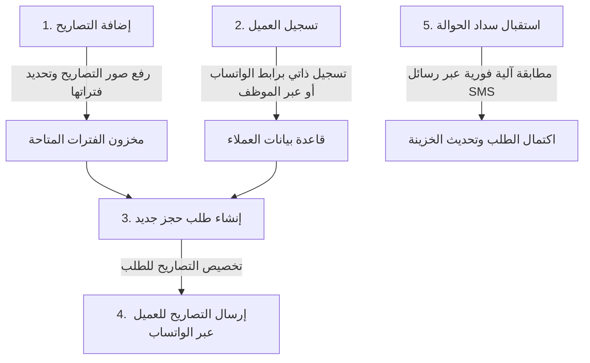

# 🤝 04: دليل تسليم المشروع للعميل — Client Handover Guide

هذا الدليل مُعد خصيصاً ليتم تقديمه للعميل النهائي (المدير العام للمؤسسة) لتشغيل واستخدام المنظومة فور استلامها بكل سهولة وسلاسة.

---

## 1. بيانات الدخول الأساسية للنظام

* 🌐 **رابط المنظومة المباشر:**  
  **[https://rawdahdeploymentready.vercel.app](https://rawdahdeploymentready.vercel.app)**
* 👤 **اسم مستخدم المدير العام (Super Admin):**  
  `admin`
* 🔑 **كلمة المرور الافتراضية:**  
  `123456789`
* 🔗 **رابط تسجيل العملاء والمعتمرين الذاتي (لإرساله في الواتساب):**  
  `https://rawdahdeploymentready.vercel.app/?register=true`

---

## 2. الخطوات الأولى للمدير العام بعد استلام النظام

### الخطوة الأولى: تغيير كلمة مرور المدير العام
1. يدخل المدير العام بحساب `admin` وكلمة المرور `123456789`.
2. من القائمة الجانبية يفتح شاشة **«الموظفين والصلاحيات»**.
3. يضغط على زر **تعديل** بجانب حساب المدير العام.
4. يكتب كلمة المرور القوية الجديدة الخاصة به ويضغط **حفظ**.

---

### الخطوة الثانية: إضافة الموظفين وتوزيع الصلاحيات
المدير العام يستطيع إدارة وإضافة طاقم العمل بالكامل من شاشة التطبيق دون الحاجة لفتح أي قواعد بيانات:
1. يضغط على **«إضافة موظف جديد»**.
2. يُدخل بيانات الموظف:
   - **الاسم بالكامل:** (مثال: أحمد محمود).
   - **اسم المستخدم:** (مثال: `ahmed` أو بالعربي `أحمد`).
   - **الدور الوظيفي:**
     - **مبيعات (Sales):** مخصص لموظفي استقبال الطلبات والعملاء وتخصيص التصاريح.
     - **مخزون وتصاريح (Inventory):** مخصص لموظفي رفع ومتابعة تصاريح الروضة وتوزيع الفترات.
     - **محاسب (Accountant):** مخصص لمتابعة السداد والتحويلات البنكية والخزينة.
   - **الصلاحيات الفرعية:** تفعيل أو تعطيل (العرض، الإضافة، التعديل، الحذف، التقارير).
   - **كلمة المرور للموظف:** (تُحدد من قبل المدير).
3. يضغط **«حفظ الموظف»**.
4. فوراً يستطيع الموظف فتح الرابط من هاتفه أو كمبيوتره وتسجيل الدخول ببياناته والبدء بالعمل.

---

### الخطوة الثالثة: ضبط بيانات المنشأة والفواتير
1. من القائمة الجانبية، فتح شاشة **«إعدادات المنشأة»**.
2. كتابة اسم المؤسسة، العنوان، أرقام الواتساب، ورقم السجل التجاري والضريبي.
3. رفع شعار المؤسسة وتحديد العملة الافتراضية (ريال سعودي).
4. تظهر هذه البيانات تلقائياً على كافة الفواتير وإيصالات المعتمرين المطبوعة.

---

## 3. دورة العمل اليومية النموذجية (Daily Workflow)

---

## 4. إرشادات هامة للمدير وفريق العمل

1. **العمل عبر الهواتف الذكية:**  
   المنظومة مصممة لتكون متجاوبة 100% مع شاشات الهواتف، ويمكن للموظفين إنجاز كافة الحجوزات وإرسال التصاريح مباشرة من جوالاتهم.
2. **إرسال التصاريح عبر الواتساب:**  
   عند فتح شاشة الطلب، يوجد زر مخصص لمشاركة صورة التصريح وتحميلها وإرسالها بضغطة زر إلى واتساب العميل بنص ترحيبي رسمي.
3. **تحديث الصفحة (Refresh):**  
   جميع البيانات محفوظة سحابياً في الوقت الفعلي، وتحديث الصفحة لا يؤثر على أي سجلات ولا يحذف أي عملاء أو طلبات.
