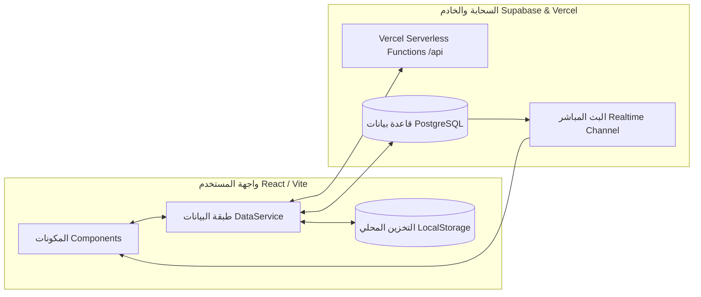

# 🛠️ الوثائق الفنية الشاملة لنظام إدارة تصاريح الروضة الشريفة (Technical Architecture & Reference)

> **المرجع التقني الكامل للمطورين ومهندسي البرمجيات لإجراء التعديلات، الصيانة، والتطوير المستقبلي.**

---

## 1. المعمارية التقنية (Technical Architecture)

النظام مبني بمعمارية **Client-First Resilient Architecture** تجمع بين:
- **المعالجة المحلية الفورية (LocalStorage First)**: استجابة فائقة السرعة للواجهات بدون انتظار الشبكة (0ms latency).
- **المزامنة السحابية اللحظية (Supabase Realtime & PostgreSQL)**: مزامنة خلفية تلقائية لجميع الأجهزة والحسابات عند توفر الاتصال.
- **العمل في وضع عدم الاتصال (Offline-Ready)**: التطبيق يعمل بكامل وظائفه حتى عند انقطاع السحابة مع المزامنة التلقائية عند عودة الاتصال.



---

## 2. هيكل المشروع والملفات (Directory Structure)

```
rawdah-permit-system/
├── api/                             # مسارات الدوال السحابية (Vercel Serverless Functions)
│   ├── audit-logs/export.ts         # تصدير سجل التدقيق CSV
│   └── export-audit-logs.ts         # مسار احتياطي لتصدير الـ CSV
├── docs/                            # التوثيق والكتيبات الاسترشادية
│   ├── USER_WORKFLOW_GUIDE.md       # دليل المستخدم والتجربة
│   ├── SYSTEM_TECHNICAL_DOCS.md     # الوثائق الفنية الشاملة
│   └── DATABASE_AND_DEPLOYMENT.md   # مرجع قاعدة البيانات والنشر
├── public/                          # الأصول الثابتة والصور والشعارات
├── src/
│   ├── components/                  # مكونات الواجهة البرمجية (React Components)
│   │   ├── Dashboard.tsx            # لوحة المؤشرات الرئيسية والتقرير اليومي للمالك
│   │   ├── OrdersManagement.tsx     # إدارة الطلبات، البحث، السحب، وواتساب
│   │   ├── PermitsInventory.tsx     # إدارة مخزون الـ 24 ساعة ونقل التصاريح
│   │   ├── CustomersCRM.tsx         # إدارة العملاء وجهات الاتصال وروابط tel/wa
│   │   ├── CustomerSelfRegister.tsx # بوابة التسجيل الذاتي للمعتمرين
│   │   ├── SmsInbox.tsx             # مركز رسائل SMS ومحرك المطابقة التلقائية
│   │   ├── FinancialAccountsView.tsx# كشف الحسابات البنكية والمحافظ
│   │   ├── EmployeesAndRolesView.tsx# إدارة الموظفين وصلاحيات الأدوار الوظيفية
│   │   ├── CompanySettingsView.tsx  # بيانات المؤسسة والشعار ومسح البيانات
│   │   ├── AuditLogViewer.tsx       # سجل العمليات وتصدير التقارير
│   │   ├── Toast.tsx                # نظام التنبيهات والإشعارات والتأكيدات
│   │   └── MyProfileModal.tsx       # نافذة الملف الشخصي للموظف
│   ├── services/                    # طبقة المنطق وخدمات البيانات
│   │   ├── dataService.ts           # المحرك الرئيسي لإدارة البيانات والعمليات
│   │   ├── supabase.ts              # مهيء الاتصال بعميل Supabase
│   │   ├── mockData.ts              # البيانات الأولية الافتراضية
│   │   └── demoData.ts              # سيناريوهات السداد التجريبي
│   ├── tests/                       # اختبارات التكامل الشاملة (E2E Integration Tests)
│   │   └── runFullWorkflowTest.ts   # سكريبت الفحص الكامل لدورة العمل
│   ├── utils/                       # الدوال المساعدة
│   │   ├── currency.ts              # دوال العملات وتنسيق المبالغ (SAR / EGP)
│   │   ├── csvHelpers.ts            # تصدير ملفات الـ CSV بأمان ضد Formula Injection
│   │   ├── passwordHash.ts          # تشفير SHA-256 لكلمات المرور
│   │   └── phoneValidation.ts       # التحقق من أرقام الهواتف السعودية والمصرية
│   ├── types/
│   │   └── index.ts                 # تعريفات الـ TypeScript والأنماط
│   ├── App.tsx                      # المكون الرئيسي وموجه التبويبات والمصادقة
│   ├── main.tsx                     # نقطة دخول تطبيق React
│   └── index.css                    # تنسيقات Tailwind والخطوط العربية
├── vercel.json                      # تكوين توجيهات Vercel ومسارات الـ SPA والـ API
├── vite.config.ts                   # تكوين Vite وتقسيم الحزم (Chunk Splitting)
└── package.json                     # تبعيات المشروع
```

---

## 3. محرك مطابقة رسائل الـ SMS (SMS Match Engine)

الخوارزمية الذكية في `dataService.ts` تدعم كشف الرسائل البنكية ومطابقتها آلياً:

1. **كشف المزود (Provider Detection)**:
   - فودافون كاش (`VF-Cash` / `Vodafone Cash`).
   - إنستاباي (`InstaPay` / `IPN`).
   - أورانج كاش (`Orange Cash`).
   - اتصالات كاش (`Etisalat Cash`).
   - مصرف الراجحي (`AlRajhiBank`).
   - البنك الأهلي (`SNB` / `AlAhli`).

2. **استخراج البيانات آلياً (Regex Extraction)**:
   - **المبلغ**: يدعم صيغ العملة العربية والإنجليزية (`300.00 ر.س`, `300.00 جنيه`, `300.00 EGP`, `SAR 300`).
   - **رقم المرجع / العملية**: (`TXN...`, `VF...`, `IPN...`).
   - **المرسل أو رقم الهاتف**: (`010...`, `05...`).

3. **المطابقة التلقائية مع الطلبات المفتوحة**:
   - يبحث المحرك عن العميل المطابق بالاسم أو رقم الهاتف.
   - يسترجع الطلب المفتوح بنفس عملة الرسالة.
   - يطبق السداد، يخفض `remainingAmount`، يحول الطلب إلى `confirmed`، ويغذي الخزينة تلقائياً.

---

## 4. نظام الصلاحيات ومصفوفة الأدوار (Role & Permissions Matrix)

| الدور الوظيفي | عرض (View) | إضافة (Create) | تعديل (Edit) | حذف (Delete) | تقارير (Reports) |
|---|:---:|:---:|:---:|:---:|:---:|
| **المدير العام (Super Admin)** | ✅ | ✅ | ✅ | ✅ | ✅ |
| **المبيعات (Sales)** | ✅ | ✅ | ✅ | ❌ | ❌ |
| **المخزون (Inventory)** | ✅ | ✅ | ✅ | ❌ | ❌ |
| **المحاسب (Accountant)** | ✅ | ❌ | ❌ | ❌ | ✅ |

---

## 5. الأمان وموثوقية البيانات (Security & Reliability)

- **تشفير كلمات المرور**: تشفير `SHA-256` عبر Web Crypto API.
- **حماية ملفات CSV**: تنظيف وحماية الخلايا من هجمات `CSV Formula Injection` ومنع الرموز الخبيثة (`=`, `+`, `-`, `@`).
- **القيد الذري لسحب التصاريح**: استخدام استعلام سحابي مشروط `WHERE status = 'available'` لمنع السحب المزدوج في نفس اللحظة من موظفين مختلفين.
