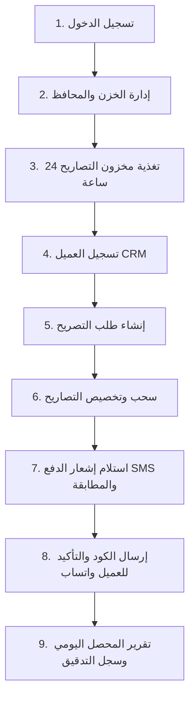

# 📖 دليل آلية العمل والتجربة الكاملة لنظام إدارة تصاريح الروضة الشريفة
> **دليل استرشادي موجّه للمستخدم / العميل لتجربة النظام بالكامل خطوة بخطوة من بداية إدخال البيانات وحتى التحصيل وإصدار التقارير.**

---

## 🎯 دورة العمل المتكاملة (Workflow Overview)

---

## 🚀 خطوات التجربة خطوة بخطوة (Step-by-Step Guide)

### 🔹 الخطوة 1: تسجيل الدخول واختيار الحساب
1. افتح رابط النظام في المتصفح.
2. يمكنك تجربة النظام من خلال الحسابات القياسية المتاحة:
   - **المدير العام (Super Admin)**: `admin` / `admin123` (صلاحيات كاملة شاملة التقارير والإعدادات ومسح البيانات).
   - **فريق المبيعات (Sales)**: `sales` / `sales123` (تسجيل العملاء، إنشاء الطلبات، ومطابقة السداد).
   - **مسؤول المخزون (Inventory)**: `inventory` / `inventory123` (رفع التصاريح، تنظيم فترات الـ 24 ساعة، وإعادة التوزيع).
   - **المحاسب المالي (Accountant)**: `accountant` / `accountant123` (الخزن، الأرصدة، التقارير المالية وكشوف الحسابات).

---

### 🔹 الخطوة 2: ضبط الخزن والمحافظ والحسابات البنكية (Financial Accounts)
1. من القائمة الجانبية ادخل على **«كشف الحسابات والخزن»**.
2. ستجد الخزن مهيأة مسبقاً:
   - **مصرف الراجحي** (SAR - ريال سعودي).
   - **فودافون كاش** (EGP - جنيه مصري).
   - **إنستاباي InstaPay** (EGP - جنيه مصري).
3. يمكنك إضافة خزنة/حساب بنكي جديد بالضغط على **«إضافة خزينة / محفظة»**.
4. تأكد من أن الرصيد يزداد تلقائياً عند تأكيد سداد أي طلب لاحقاً.

---

### 🔹 الخطوة 3: تغذية المخزون بالتصاريح (Permits Inventory)
1. ادخل على شاشة **«المخزون والتصاريح»**.
2. **عرض الـ 24 ساعة**: ستجد توزيع الساعات على مدار اليوم (صباحاً ومساءً).
3. **إضافة / رفع تصاريح**:
   - اضغط على **«إضافة تصاريح جديدة»** (أو رفع صور جماعية).
   - حدد التاريخ، الساعة (مثلاً `14:00` أو `20:00`)، وادخل كود التصريح وصورة الكود QR.
4. **تجربة النقل وإعادة التوزيع**:
   - اضغط على زر **«إعادة توزيع»** أو **«نقل»** في أي فترة لتجربة نقل التصاريح من ساعة إلى ساعة أخرى فورياً.

---

### 🔹 الخطوة 4: تسجيل العملاء (Customers CRM)
1. ادخل على شاشة **«إدارة العملاء CRM»**.
2. اضغط على **«إضافة عميل جديد»**.
3. ادخل بيانات العميل:
   - **الاسم الثلاثي**: (مثال: محمد عبدالله السعيد).
   - **رقم الواتساب**: يدعم الأرقام السعودية والمصرية (مثال: `0551234567` أو `+966551234567`).
   - **هاتف إضافي**: (اختياري).
   - **اللقب والملاحظات**: (مثال: معتمر VIP).
4. اضغط **حفظ العميل**.
5. ستلاحظ ظهور أزرار التفاعل الفوري:
   - أيقونة الواتساب 💬 لفتح محادثة فورية.
   - أيقونة الهاتف 📞 للاتصال الهاتفي المباشر (`tel:`).

---

### 🔹 الخطوة 5: إنشاء طلب حجز جديد (Create Order)
1. ادخل على شاشة **«إدارة الطلبات»**.
2. اضغط على **«إنشاء طلب جديد»**.
3. حدد البيانات:
   - **العميل**: اختر العميل المسجل في الخطوة السابقة.
   - **تاريخ وموعد الزيارة**: حدد الموعد المطلوب.
   - **عدد التصاريح**: حدد عدد الرجال والنساء (مثلاً 2 تصريح).
   - **السعر الإجمالي والعملة**: (مثلاً 300 ر.س).
4. اضغط **إنشاء الطلب**.
5. سيظهر الطلب في جدول الطلبات بحالة **«جارٍ البحث عن تصاريح»** وموقف السداد **«متبقي 300 ر.س»**.

---

### 🔹 الخطوة 6: سحب وتخصيص التصاريح للطلب (Claim Permits)
1. من صفحة **«إدارة الطلبات»** اضغط على زر سحب/تخصيص التصاريح أو من صفحة المخزون.
2. اختر التصاريح المتاحة من المخزون واضغط **تخصيص للطلب**.
3. ستتحول حالة الطلب تلقائياً إلى **«مؤكد»** وترتبط صور أكواد التصاريح بملف الطلب.

---

### 🔹 الخطوة 7: استقبال إشعار الدفع البنكي SMS والمطابقة الذكية
1. ادخل على شاشة **«مركز رسائل SMS والسداد»**.
2. **لتجربة المطابقة التلقائية الذكية**:
   - اضغط على **«محاكاة استقبال رسالة SMS»**.
   - اختر نموذج رسالة تحويل من مصرف الراجحي أو فودافون كاش بنفس مبلغ واسم العميل (300 ر.س).
   - اضغط **إرسال**.
   - ✨ **ستلاحظ**: محرك الذكاء الاصطناعي يستخرج المبلغ واسم العميل تلقائياً، ويطابق الرسالة بالطلب، ويصفر المبلغ المتبقي، ويطلق احتفال النجاح (Confetti).
3. **لتجربة المطابقة اليدوية**:
   - الصق رسالة تحويل من رقم مجهول.
   - اضغط زر **«مطابقة وسداد»** في بطاقة الرسالة.
   - ستظهر قائمة الطلبات غير المسددة فقط، اختر الطلب واضغط **تأكيد السداد**.

---

### 🔹 الخطوة 8: إرسال التصاريح للعميل عبر الواتساب (Delivery)
1. ارجع لشاشة **«إدارة الطلبات»**.
2. اضغط على أيقونة **الواتساب الخضراء** بجانب الطلب المؤكد.
3. ستفتح نافذة جاهزة تحتوي على:
   - رسالة منسقة رسمية باسم العميل، رقم الطلب، وموعد الزيارة.
   - كود التصريح ورابط الصورة.
4. اضغط **إرسال عبر واتساب** وسيتم تحديث موقف الإرسال إلى **«تم الإرسال للعميل»**.

---

### 🔹 الخطوة 9: تقرير التحصيل اليومي وسجل التدقيق (Reports & Audit)
1. **التقرير اليومي للمالك / لوحة المؤشرات (Dashboard)**:
   - يظهر إجمالي المبالغ المحصلة، عدد التصاريح المسحوبة، ورسالة واتساب ملخصة بتقرير آخر اليوم جاهزة للمالك بضغطة زر.
2. **تقرير المحصلين (Collector Report)**:
   - يوضح ما قام كل موظف بتحصيله وسحبه لحسابه بدقة ومنع أي تداخل مالي.
3. **سجل العمليات (Audit Logs)**:
   - ادخل على شاشة **«سجل العمليات»** لمشاهدة كل عملية موثقة بالثانية واسم الموظف والتفاصيل.
   - اضغط زر **«تصدير CSV»** لتنزيل ملف إكسل رسمي بالعمليات.

---

✅ **انتهت دورة العمل بنجاح تام!**
