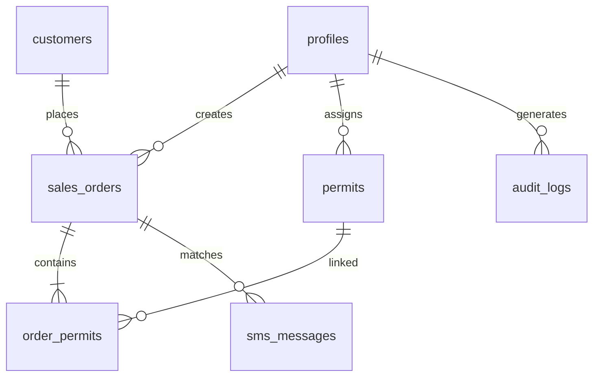

# 🕌 دليل النظام الشامل والتوثيق التقني لمنظومة تصاريح الروضة الشريفة
**النسخة:** 2.1 (Production Ready)  
**تاريخ التوثيق:** 18 أكتوبر 2026  
**الرابط الحي المعتمد:** [https://rawdahdeploymentready.vercel.app](https://rawdahdeploymentready.vercel.app)

---

## 📑 فهرس المحتويات
1. [نظرة عامة على النظام والهدف منه](#1-نظرة-عامة-على-النظام-والهدف-منه)
2. [البنية التقنية والمعمارية (Architecture & Tech Stack)](#2-البنية-التقنية-والمعمارية)
3. [مخطط قاعدة البيانات وجداول Supabase (Database Schema)](#3-مخطط-قاعدة-البيانات-وجداول-supabase)
4. [دورات العمل التشغيلية خطوة بخطوة (Operational Workflows)](#4-دورات-العمل-التشغيلية-خطوة-بخطوة)
   - [أ. نظام الفترات الـ 72 الذكي](#أ-نظام-الفترات-الـ-72-الذكي)
   - [ب. دورة حياة التصريح والمخزون](#ب-دورة-حياة-التصريح-والمخزون)
   - [ج. دورة مبيعات الطلبات ومراسلة الواتساب](#ج-دورة-مبيعات-الطلبات-ومراسلة-الواتساب)
   - [د. المحاسبة ومطابقة رسائل البنوك SMS](#د-المحاسبة-ومطابقة-رسائل-البنوك-sms)
5. [آلية الشفاء الذاتي وحل مشكلة ذاكرة الجوال (Storage Self-Healing)](#5-آلية-الشفاء-الذاتي-وحل-مشكلة-ذاكرة-الجوال)
6. [نظام الصلاحيات والأمان (RBAC & RLS)](#6-نظام-الصلاحيات-والأمان)
7. [دليل النشر السحابي ومتغيرات البيئة (Deployment & Config)](#7-دليل-النشر-السحابي-ومتغيرات-البيئة)
8. [دليل حل المشاكل الشائعة والأسئلة المتكررة (Troubleshooting & FAQ)](#8-دليل-حل-المشاكل-الشائعة-والأسئلة-المتكررة)

---

## 1. نظرة عامة على النظام والهدف منه

منظومة **تصاريح الروضة الشريفة** هي منصة متكاملة مخصصة لشركات ووكالات تنظيم رحلات العمرة والزيارة. تهدف إلى:
* تنظيم وإدارة مخزون تصاريح الروضة الشريفة على مدار 24 ساعة مقسمة بدقة إلى فترات مدتها 20 دقيقة.
* إدارة طلبات العملاء وحجوزاتهم، وتخصيص التصاريح المناسبة لكل عميل فورياً.
* تسليم التصاريح وصورها الرسمية للعملاء عبر الواتساب بأسرع وأسهل آلية.
* حوكمة العمليات المالية وتتبع تحصيل كل موظف يومياً بدقة لمنع التلاعب أو الأخطاء الحسابية.
* استقبال ومطابقة إشعارات التحويلات البنكية (SMS) آلياً دون تدخل بشري.

---

## 2. البنية التقنية والمعمارية

النظام مبني وفق معمارية حديثة تجمع بين السرعة الفائقة والاعتمادية العالية:

* **الواجهة الأمامية (Frontend):**
  * `React 18` مع `TypeScript` لضمان أمان الأنواع البرمجية وعدم وجود أخطاء وقت التشغيل.
  * `Tailwind CSS` لتصميم عربي فاخر، متجاوب، ومتوافق مع شاشات الجوال والأجهزة اللوحية والكمبيوتر.
  * `Vite 6` كأداة بناء فائقة السرعة مع تقطيع الحزم (`Code Splitting`) لتوفير سرعة تحميل خارقة.
  * `Lucide React` لأيقونات واضحة وعصرية.
  * `Canvas Confetti` لمؤثرات الاحتفال عند نجاح سحب التصاريح.

* **الواجهة الخلفية وقاعدة البيانات (Backend & Cloud):**
  * `Supabase` المبني على `PostgreSQL 15+`.
  * `Supabase Auth` لمصادقة الموظفين المشفرة.
  * `Supabase Realtime` للبث اللحظي للبيانات؛ أي تعديل من موظف يظهر لجميع الموظفين الآخرين فوراً دون الحاجة لتحديث الصفحة.
  * `Row Level Security (RLS)` لحماية البيانات وضمان عدم وصول أي شخص لبيانات غير مصرح له بها.

* **محرك التخزين الهجين (Local-First Engine):**
  * يعمل النظام بآلية التخزين المحلي-أولاً (`LocalStorage`) المتزامن مع السحابة، مما يسمح للموظفين بالعمل بسلاسة فائقة حتى في حالات تذبذب شبكة الإنترنت.

---

## 3. مخطط قاعدة البيانات وجداول Supabase

تتكون قاعدة البيانات في `database/schema.sql` من 9 جداول رئيسية متكاملة:



### 1. جدول الموظفين والملفات الشخصية (`profiles`)
* المفتاح الأساسي: `id UUID` (مرتبط بـ `auth.users`).
* الحقول: `full_name`, `username`, `phone_number`, `whatsapp_number`, `role`, `is_active`, `custom_permissions JSONB`.

### 2. جدول إعدادات المنشأة (`company_settings`)
* يحفظ اسم الشركة بالعربي والإنجليزي، الشعار، الأرقام، الرقم الضريبي، العملة الافتراضية، وملاحظات الفاتورة.

### 3. جدول العملاء (`customers`)
* المفتاح الأساسي: `id UUID`.
* الحقول: `full_name`, `whatsapp_number` (بالصيغة الدولية), `additional_phone`, `nickname`, `total_orders_count`, `total_spent`.

### 4. جدول تصاريح الروضة (`permits`)
* المفتاح الأساسي: `id UUID`.
* الحقول: `permit_code` (كود التصريح), `slot_date` (تاريخ الزيارة), `slot_hour` (الساعة 0-23), `slot_minute` (0 أو 20 أو 40), `image_url` (صورة التصريح المضغوطة), `status` (`available`, `assigned`, `locked`, `returned`, `cancelled`), `assigned_to_customer_id`, `assigned_by_user_id`.

### 5. جدول طلبات المبيعات (`sales_orders`)
* المفتاح الأساسي: `id UUID`.
* الحقول: `order_number` (رقم تسلسلي تلقائي), `customer_id`, `permits_count`, `permits_count_male`, `permits_count_female`, `total_amount`, `paid_amount`, `remaining_amount`, `order_status`, `delivery_status`, `payments JSONB` (سجل السدادات التفصيلية لكل موظف).

### 6. جدول وصل التصاريح بالطلبات (`order_permits`)
* جدول ربط وسيط (Many-to-Many) يربط كل طلب بالتصاريح المحددة التي سُحبت لصالحه.

### 7. جدول الحسابات والخزائن المالية (`financial_accounts`)
* يمثل الخزائن النقدية، الحسابات البنكية، والمحافظ الإلكترونية (`cash`, `bank`, `wallet`).
* تُعدل أرصدته عبر دالة آمنة مشفرة `rpc_adjust_balance`.

### 8. جدول رسائل الدفع البنكية (`sms_messages`)
* يحفظ نصوص رسائل الإيداع البنكية، المبلغ المستخرج، رقم المرجع، المزود، ورقم الطلب الذي طوبقت معه.

### 9. جدول التدقيق وسجل العمليات (`audit_logs`)
* جدول غير قابل للتعديل يسجل كل حركة تتم على النظام (سحب، نقل، سداد، حذف، دخول) واسم الموظف وتوقيت الرياض الدقيق.

---

## 4. دورات العمل التشغيلية خطوة بخطوة

### أ. نظام الفترات الـ 72 الذكي
* اليوم مقسم إلى 24 ساعة.
* كل ساعة مقسمة إلى 3 فترات زمنية:
  * الدقيقة `00:` (مثال: 08:00 إلى 08:20)
  * الدقيقة `20:` (مثال: 08:20 إلى 08:40)
  * الدقيقة `40:` (مثال: 08:40 إلى 09:00)
* إجمالي الفترات اليومية = 72 فترة. يوضح النظام حالة كل فترة (كم متاح، كم محجوز، وكم مقفل).

### ب. دورة حياة التصريح والمخزون
1. **الرفع والإدخال:** رفع التصاريح فرادى أو كحزمة؛ تُضغط الصورة آلياً قبل الحفظ إلى أبعاد مناسبة (800px) وجودة 78% لتوفير المساحة.
2. **السحب والتخصيص:** يختار موظف المبيعات التصريح المتاح وينقر «سحب وتخصيص لعميل» ويربطه بطلب العميل.
3. **النقل وإعادة التوزيع (Rebalance):** في حال تغير موعد الفوج، يمكن نقل تصريح مفرد أو كافة تصاريح الفترة إلى موعد جديد بضغطة زر.
4. **الحذف والتفريغ:** في حال تم رفع تصريح بالخطأ، يوجد زر **«حذف»** أحمر على الكارت وفي نافذة المعاينة، يحذف التصريح فوراً ويفرغ مساحته من الذاكرة.

### ج. دورة مبيعات الطلبات ومراسلة الواتساب
1. **إنشاء الطلب:** تحديد العميل وعدد التصاريح المطلوبة والمبلغ المدفوع مقدماً.
2. **سحب التصاريح:** سحب العدد المطلوب من الفترات المناسبة.
3. **إرسال الواتساب:**
   - يفتح الموظف زر «واتساب» على الطلب.
   - **على الجوال:** يضغط زر «إرسال» بجانب صورة التصريح لتفتح قائمة مشاركة الجوال ويرسل الصورة مباشرة كملف بالواتساب.
   - **على الكمبيوتر:** يضغط زر «نسخ» ثم يفتح الواتساب ويب ويضغط (`Ctrl + V`) للصق الصورة فوراً.
   - ثم يضغط «فتح الواتساب ومراسلة العميل» لإرسال نص التأكيد وتفاصيل الموعد.

### د. المحاسبة ومطابقة رسائل البنوك SMS
1. **تسجيل السداد:** أي مبلغ يُدفع (أولي أو لاحق) يُسجل فوراً باسم الموظف الحالي في حقل `order.payments`.
2. **تقرير تحصيل اليوم:** يظهر في الشاشة الرئيسية كارت: «تحصيل اليوم لكل موظف — عشان تحاسبهم آخر اليوم»، يوضح اسم كل موظف وإجمالي ما قبضه نقداً أو سدادات ليتم تسليمه للخزينة.
3. **مطابقة SMS:** عند وصول رسالة بنكية، يقوم النظام باستخراج المبلغ وتجاوز الفواصل النقدية (`1,500` تصبح `1500`)، وبمجرد اختيار الطلب يتم سداده وتعديل رصيد الحساب المالي آلياً.

---

## 5. آلية الشفاء الذاتي وحل مشكلة ذاكرة الجوال

تفرض متصفحات الهواتف حداً أقصى للتخزين المحلي قدره 5 ميجابايت. تم ابتكار نظام أمان ثلاثي يمنع تعطل التطبيق نهائياً:

1. **الضغط عند الرفع:** أي صورة يتم رفعها تُقلص أبعادها إلى 800 بكسل وجودة 78%، مما يقلل حجمها بنسبة تفوق 65% مع بقاء وضوح الباركود والنصوص بنسبة 100%.
2. **نظام الشفاء عند الإقلاع (`selfHealStorage`):** بمجرد فتح التطبيق، يتم فحص حجم الذاكرة تلقائياً؛ فإذا تجاوزت التصاريح القديمة حداً آمناً، يتم تجريد الصور القديمة غير المستخدمة والإبقاء على البيانات الوصفية، مما يوفر 4+ ميجابايت في جزء من الثانية.
3. **زر تفريغ الذاكرة المؤقتة:** موجود في شاشة تسجيل الدخول (`🧹 تفريغ مساحة المتصفح وحل امتلاء التخزين`) وفي أعلى شاشة المخزون بنقرة واحدة لأي مستخدم يواجه مشكلة في جهازه القديم.

---

## 6. نظام الصلاحيات والأمان (RBAC & RLS)

* **الأدوار المعتمدة:**
  * `super_admin`: صلاحيات كاملة غير مقيدة على النظام والسحابة والإعدادات.
  * `sales`: إنشاء الطلبات، سحب التصاريح، تسجيل السداد، ومراسلة العملاء.
  * `inventory`: رفع التصاريح، إعادة توزيع الفترات، وإدارة المخزون وحذفه.
  * `supervisor`: متابعة العمليات ومراقبة حركة الفترات والمبيعات.
  * `finance`: إدارة الحسابات المالية وتقارير التحصيل وصندوق رسائل البنوك.
* **سياسات الأمان (Row Level Security):** جداول السحابة محمية بقيود تمنع المستخدم العادي من تعديل أرصدة الحسابات أو قراءة سجلات التدقيق بدون تصريح رسمي.

---

## 7. دليل النشر السحابي ومتغيرات البيئة

### متغيرات البيئة في `.env` و `.env.local`
```env
VITE_SUPABASE_URL=https://aeuavoqhrhzsxblrddlc.supabase.co
VITE_SUPABASE_ANON_KEY=sb_publishable_8yWMCFKNbdOnAfLjpmKBlA_kSWTdx66
VITE_SMS_WEBHOOK_SECRET=rawdah_sec_2026
```

### ملف تكوين Vercel (`vercel.json`)
يحتوي على إعدادات توجيه المسارات (`rewrites`) وسياسة أمان المحتوى (`CSP`) التي تسمح بالاتصال المباشر بنطاق Supabase:
```json
"connect-src 'self' https://*.supabase.co wss://*.supabase.co https://*.vercel.app"
```

### أوامر النشر المباشر
* لبناء حزمة الإنتاج محلياً:
  ```powershell
  npm run build
  ```
* للنشر المباشر على منصة Vercel للإنتاج:
  ```powershell
  npx vercel deploy --prod --yes
  ```

---

## 8. دليل حل المشاكل الشائعة والأسئلة المتكررة

### س1: ظهرت رسالة "مساحة التخزين ممتلئة" على جوال قديم؟
* **الحل:** في أسفل شاشة تسجيل الدخول، اضغط على زر **«🧹 تفريغ مساحة المتصفح وحل امتلاء التخزين»**، أو من داخل المخزون اضغط زر **«تفريغ وضغط الذاكرة»**. سيتم تنظيف مخلفات التصفح فوراً وتحديث الصفحة.

### س2: كيف أقوم بإضافة موظف جديد وتحديد كلمة مرور له؟
* **الحل:**
  1. ادخل على لوحة تحكم `Supabase` > `Authentication` > `Users` > اضغط `Add User`.
  2. البريد الإلكتروني: `<username>@rawdah.app` (حيث username هو نفس اسم المستخدم المسجل في شاشة الموظفين بالتطبيق).
  3. ضع علامة صح على **Auto Confirm User** واكتب كلمة المرور المؤقتة.
  4. سيتمكن الموظف من تسجيل الدخول فوراً باسم المستخدم وكلمة المرور من أي جهاز.

### س3: كيف أسترجع تصريحاً سُحب لعميل بالخطأ؟
* **الحل:** في شاشة الفترات، قف على التصريح المخصص (الأزرق)، واضغط زر **«إرجاع»**، وسيعود فوراً للمخزون المتاح للبيع.

### س4: هل يحتاج العميل لتحميل أي تطبيق لتسجيل بياناته؟
* **الحل:** لا، فقط أرسل له رابط التسجيل الذاتي المباشر:  
  `https://rawdahdeploymentready.vercel.app/?register=true`  
  ليقوم بكتابة اسمه ورقمه الدولي وحفظه في ثوانٍ.

---
**تم إعداد هذا التوثيق ليكون دليلاً مرجعياً ثابتاً ودائماً لكافة عمليات التطوير والتشغيل اليومي لمنظومة تصاريح الروضة الشريفة.**
